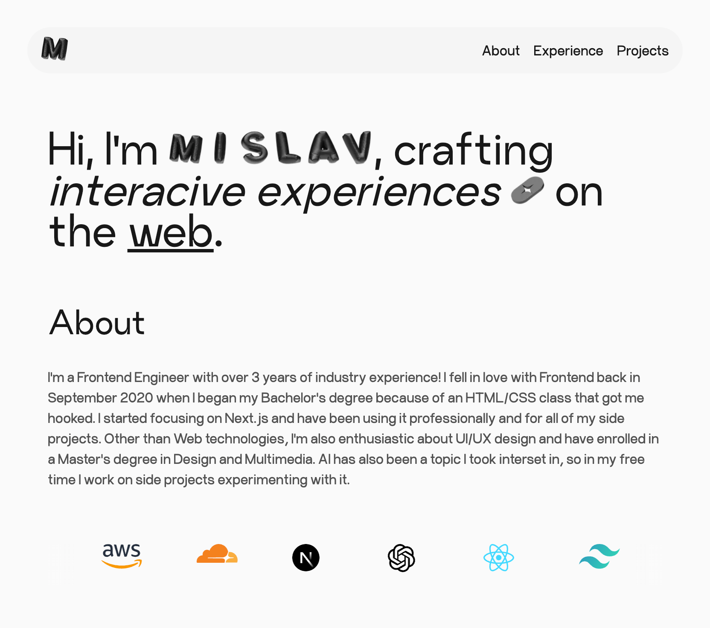

# Portfolio

Repository for my personal portfolio website.



## Tech Stack

**Frontend:** Next.js, TailwindCSS

## Run Locally

Clone the project

```bash
  git clone https://github.com/mislavjc/www.git
```

Go to the project directory

```bash
  cd www
```

Install dependencies

```bash
  bun install
```

Start the dev server

```bash
  bun dev
```
